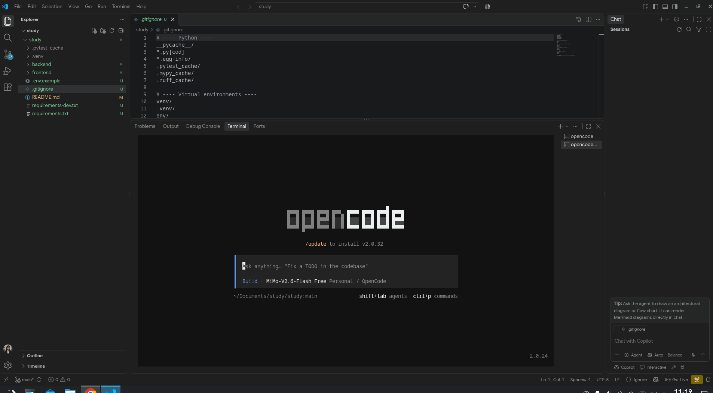

# lazycode-ai
# LazyCode AI 🚀

**Understand code easily with your own local AI assistant.**

LazyCode AI is a simple web application that explains source code in easy-to-understand English. It uses Flask for the backend and Ollama to run a local AI model.

## ✨ Features

- Explain code in simple English.
- Describe how code works step by step.
- Show the expected output and key concepts.
- Run AI explanations using a local Ollama model (`qwen2.5-coder:3b`).
- Professional dark developer dashboard: left navigation, central workspace, right history panel.
- Code editor with syntax highlighting (CodeMirror) for 18 languages.
- Explanation history saved in your browser (localStorage) — reopening and search included.
- Real Ollama connection status in the top bar (never faked).
- Ready-to-use code templates you can load into the editor.
- Fully responsive for desktop, tablet, and mobile.

## 🗂️ Project Structure

```
lazycode-ai/
├── app.py                     # Flask backend (/, /explain, /api/status)
├── templates/
│   └── index.html             # Dashboard layout
├── static/
│   ├── style.css              # Dark theme styling
│   ├── script.js              # Frontend logic, safe Markdown rendering, history
│   └── vendor/codemirror/     # Vendored CodeMirror editor (works offline)
├── README.md
└── CONTRIBUTING.md
```

## 🛠️ Technologies Used

- Python
- Flask
- HTML, CSS and JavaScript
- Ollama
- Qwen2.5-Coder 3B

## 📋 Requirements

- Python 3
- Git
- Ollama
- The `qwen2.5-coder:3b` model

## ⚙️ Installation

### 1. Clone the repository

```bash
git clone https://github.com/chandrua138/lazycode-ai.git
cd lazycode-ai
```

### 2. Create a virtual environment

```bash
python3 -m venv .venv
source .venv/bin/activate
```

### 3. Install dependencies

```bash
pip install flask requests
```

### 4. Install the Ollama model

Install Ollama from https://ollama.com/ if you haven't already, then run:

```bash
ollama pull qwen2.5-coder:3b
```

### 5. Start the application

Make sure Ollama is running, then run:

```bash
python app.py
```

Open http://127.0.0.1:5000 in your browser.

## 💡 Example

Input:

```python
for i in range(3):
    print(i)
```

Expected output:

```text
0
1
2
```

LazyCode AI can explain the loop and how it produces this output.

## 🤝 Contributing

Contributions, suggestions, bug reports, and improvements are welcome!

Please read [CONTRIBUTING.md](CONTRIBUTING.md) before submitting changes.

## 📄 License

No license has been specified yet. A license can be added when the project owner chooses one.

## 📸 Screenshot


